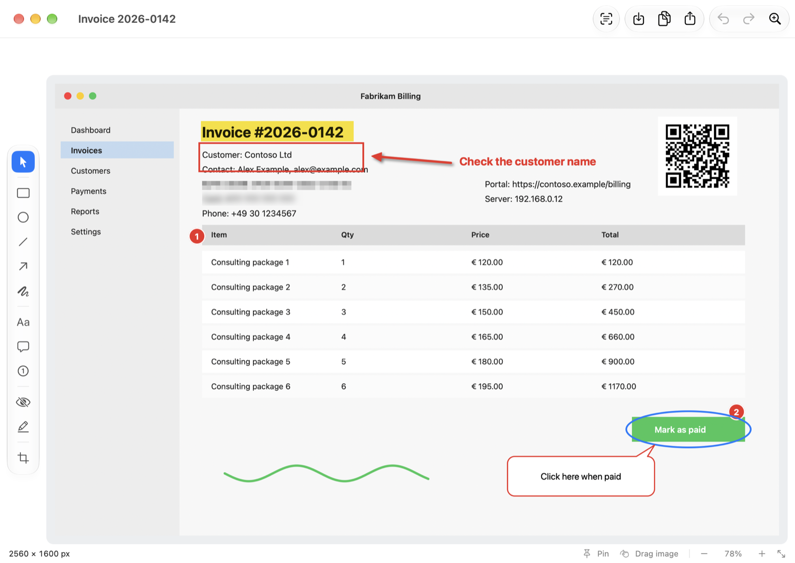
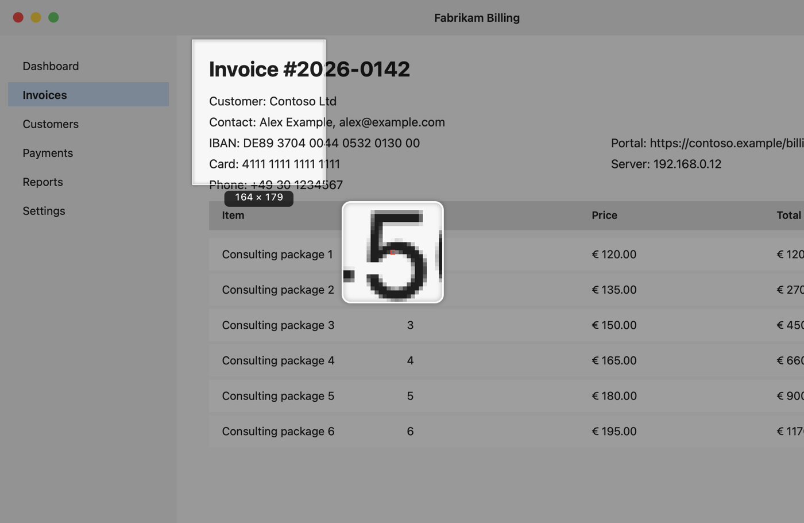
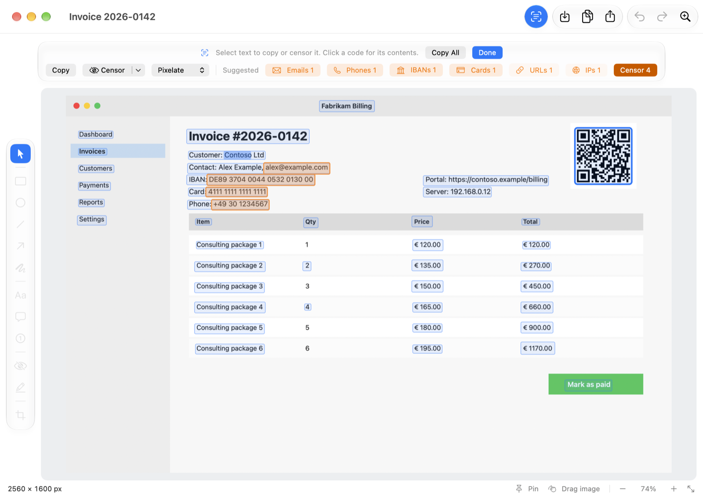
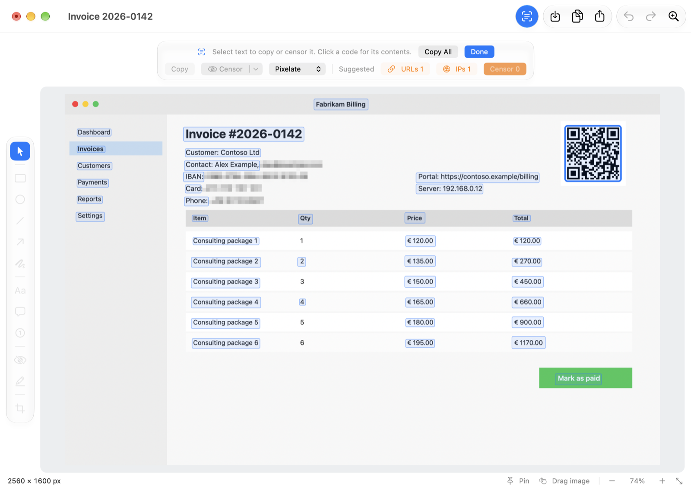

  

<h1 align="center">WhiteShot</h1>

  <b>Screenshots for the Mac with a frozen screen, a real editor and a censor tool that understands text.</b> 
  Inspired by <a href="https://getgreenshot.org">Greenshot</a> for Windows.

  <a href="../../releases/latest"><b>Download for macOS</b></a> ·
  <a href="#what-it-does">Features</a> ·
  <a href="#faq">FAQ</a> ·
  <a href="../../issues">Report an issue</a>

  
  
  

  <picture>
    <source media="(prefers-color-scheme: dark)" srcset="docs/editor-dark.png">
    
  </picture>

WhiteShot lives in your menu bar. Press a shortcut, the screen freezes, you drag over what you want, and the result goes wherever you like: the editor, the clipboard, a file, a floating pin on your screen. In the editor you draw, annotate and, above all, **censor** — by hand, or by pointing at the text you want gone.

Everything happens on your Mac. There are no accounts, no uploads and no analytics.

## Download

1. Get **WhiteShot-x.y.z.dmg** from the [latest release](../../releases/latest).
2. Open it and drag **WhiteShot** to **Applications**.
3. Start WhiteShot. It appears in the menu bar as a viewfinder icon and does not show up in the Dock until a window is open.

WhiteShot needs **macOS 14 (Sonoma) or newer** and has the Liquid Glass look on macOS 26. The app is signed and notarized by Apple, so it opens without warnings.

### The first time: allow screen recording

macOS only lets an app capture the screen once you allow it. WhiteShot asks when it starts. If you missed the question, open **System Settings › Privacy & Security › Screen & System Audio Recording**, switch **WhiteShot** on, then quit and reopen WhiteShot (macOS applies the permission to apps that start afterwards). The permission is used only to take the screenshots you ask for.

## What it does

### Capture

- **A frozen screen.** Press the shortcut and the screen freezes, so menus, tooltips and video frames stay exactly as they were. Drag a region with a pixel-level magnifier. Hold <kbd>Shift</kbd> for a square, <kbd>⌥</kbd> to grow from the centre, <kbd>Space</kbd> to move the selection, <kbd>Esc</kbd> to cancel.
- **Everything else you would expect:** the full screen, all displays at once, the last region again, and single windows (hover and click, or pick one from a list). Optional mouse pointer, optional countdown.
- **Windows with or without their shadow,** on a transparent, white or black background.

  

### Send it anywhere, in any combination

After each capture WhiteShot can open the editor, copy to the clipboard, save to a file, ask for a file name, print, open the Share sheet, start an email or **pin it to the screen**. Tick any combination, or have it ask each time, and switch destinations right from the menu bar. Out of the box a capture opens in the editor, is copied to the clipboard and is saved to `~/Pictures/WhiteShot`.

### Edit

- **An editor window for every screenshot.** Open as many as you like at the same time.
- **Draw and annotate:** rectangle, ellipse, line, arrow, freehand, text, speech bubble, auto-numbered step labels, marker, spotlight, grayscale and magnify highlights, pasted or dropped images, shadows, ordering, copy/paste and unlimited undo.
- **Censor:** pixelate, blur or black out.
- **Image tools:** crop with a live size read-out, auto-crop, rotate, flip, resize, canvas size, drop shadow, border, torn edge, brightness / contrast / gamma, grayscale and invert.
- **Colours by code.** Every colour has a screen eyedropper that shows the hex and RGB codes, and hex or RGB values can be typed in.
- **Save as** PNG, JPEG, GIF, TIFF, BMP or HEIC. Retina captures keep their size, and file names come from a pattern you can change (the default is `SCR_2026-11-06_14-30-05-123`).

### Recognize text and censor it

The text button in the editor toolbar reads the picture with Apple's text recognition, entirely on your Mac. Every line it finds lies over the text in the picture: drag to select, double-click for a word, triple-click for a line, <kbd>⌘A</kbd> for everything and <kbd>⌘C</kbd> to copy.

  

- **Censor what you select,** or **Censor All Occurrences** to cover a name everywhere it appears. Choose pixelate, blur or black out.
- **Suggestions.** Email addresses, phone numbers, IBANs and card numbers are marked in orange (IBANs and cards are checksum-checked, so random numbers are not flagged). One click censors them. Web and IP addresses can be switched on too. Nothing is ever censored without your click.
- **QR codes and barcodes** are outlined. Click one to copy its content, or to open it when it is a web or mail link.
- Text under a censoring box is never offered for copying and never saved.

  

**Grab Text** works without opening the editor at all: press the shortcut, select a region, and the text and QR codes in it are on your clipboard.

If you save a picture after recognizing its text, PNG, JPEG, TIFF and HEIC files keep that text in their image description (switch it off in Settings › Text).

### Pin, drag, share

- **Pin to screen.** Keep a screenshot floating above your other windows, right where you captured it. Drag it around, pinch to resize, change its opacity from the right-click menu, double-click to open it in the editor.
- **Drag the image out.** The **Drag image** handle in the editor's status bar hands the picture, with all your annotations, to Mail, Slack, the Finder or any other app that accepts files.
- **Share, email and print** are in the toolbar and the File menu.

## Shortcuts

WhiteShot ships with shortcuts that do not collide with macOS' own screenshot keys. In **Settings › Shortcuts** you can switch to a macOS-style set, record your own, and give any action a **second shortcut** (for example a special key on your keyboard). Both work at the same time.

| Action | WhiteShot's own (default) | macOS-style set |
| --- | --- | --- |
| Capture region | <kbd>⌃⇧4</kbd> | <kbd>⇧⌘4</kbd> |
| Capture last region | <kbd>⌃⇧6</kbd> | <kbd>⇧⌘6</kbd> |
| Capture full screen | <kbd>⌃⇧3</kbd> | <kbd>⇧⌘3</kbd> |
| Capture window | <kbd>⌃⇧5</kbd> | <kbd>⇧⌘5</kbd> |
| Grab text | <kbd>⌃⇧7</kbd> | <kbd>⇧⌘7</kbd> |

macOS gives its own screenshot shortcuts priority. To use the macOS-style set, first switch those off in **System Settings › Keyboard › Keyboard Shortcuts › Screenshots**; WhiteShot tells you in Settings when a shortcut is being shadowed.

In the editor, single keys choose the tools: <kbd>V</kbd> select, <kbd>R</kbd> rectangle, <kbd>E</kbd> ellipse, <kbd>L</kbd> line, <kbd>A</kbd> arrow, <kbd>F</kbd> freehand, <kbd>T</kbd> text, <kbd>B</kbd> speech bubble, <kbd>N</kbd> step number, <kbd>O</kbd> censor, <kbd>H</kbd> highlight, <kbd>C</kbd> crop. Hold <kbd>Shift</kbd> while drawing for squares, circles and straight lines. <kbd>⇧⌘T</kbd> turns text recognition on, <kbd>⇧⌘P</kbd> pins the picture, <kbd>⇧⌘C</kbd> copies it.

## Updates

WhiteShot checks GitHub once a day for a newer release and tells you when there is one. It never downloads or installs anything by itself, and you can turn the check off in **Settings › General**. The version you are running is the version of the release it was built from.

## FAQ

**Nothing happens when I press the shortcut, or I only get my desktop wallpaper.**
Screen recording is not allowed yet. See [the first time](#the-first-time-allow-screen-recording), and restart WhiteShot after allowing it.

**macOS still takes the shortcut for its own screenshot.**
Its own shortcuts win. Keep WhiteShot's default set, or switch the macOS ones off as described under [Shortcuts](#shortcuts).

**Can I select a region across two displays?**
Not yet: a selection stops at the edge of the display where you started. Use **Capture All Displays** (menu bar and Capture menu), which stitches all displays into one picture, then crop it in the editor. Displays with different resolutions are brought to the sharpest one's scale.

**The first text recognition takes a long time.**
The first run after installing can take a while while macOS prepares its text model. After that it takes a fraction of a second.

**Is the original kept in a `.whiteshot` project?**
Yes. A project (Save As › WhiteShot Project) keeps the original picture and your annotations editable, which also means the uncensored original is inside the file. Export a PNG or JPEG to share a censored picture.

**Where do I change the language?**
Settings › General. WhiteShot follows your Mac's language (English or German) by default.

## Not included

Greenshot has a few things WhiteShot leaves out on purpose or has not done yet: plugins and image-host uploads, scrolling capture, reducing colours, Internet Explorer capture, inserting a window into an open picture and a region that spans several displays.

## Feedback

Found a bug or missing something? [Open an issue](../../issues). Pull requests are welcome; see [CONTRIBUTING.md](CONTRIBUTING.md).

## License

WhiteShot is free software under the [GNU General Public License, version 3](LICENSE). It is written from scratch and contains no Greenshot code; "Greenshot" is the name of an unrelated project whose workflow inspired this one. Text recognition uses Apple's Vision framework on your Mac.
